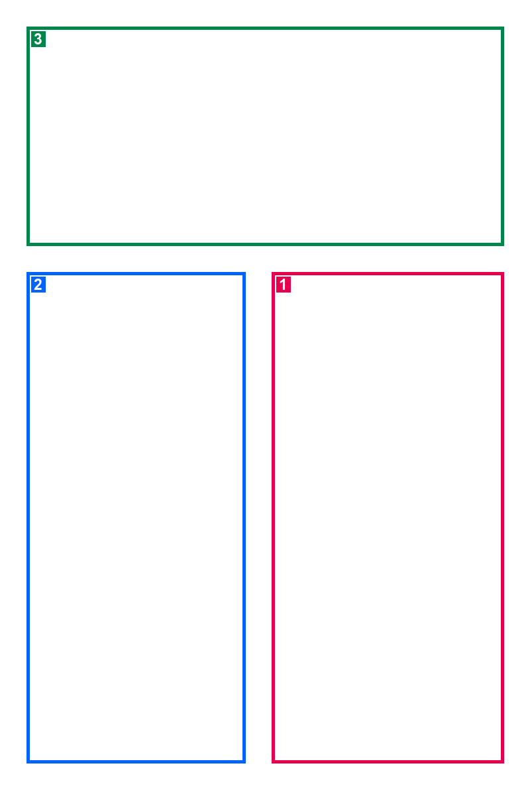
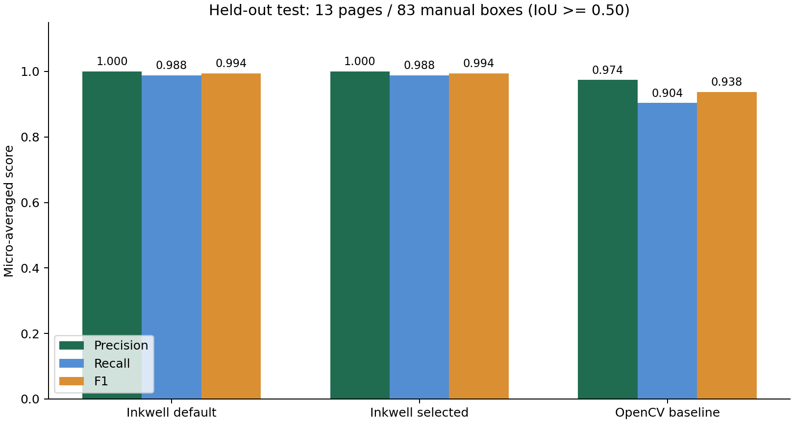

# 漫画分镜检测与导出助手

为早期漫画与未翻译漫画的读者提供分镜定位、局部放大阅读材料和人工翻译整理辅助。
采用预训练Inkwell YOLOv8-n ONNX权重与本地规则任务Agent，提供网页上传、彩色/灰度预览、
分镜裁剪、边界JSON下载，以及独立的人工标注和评估工具。运行时不需要大模型API。

这是从私有课程项目独立整理的公开提交版。未自行训练或微调；不包含OCR、翻译、阅读顺序预测。
检测框为轴对齐外接矩形，编号不表示阅读顺序，裁剪结果需要人工核验。

## 快速运行

推荐Windows与Python 3.9.13。在本文件所在目录打开PowerShell：

```powershell
py -3.9 -m venv .venv
& .\.venv\Scripts\python.exe -m pip install -r requirements-lock.txt
& .\.venv\Scripts\python.exe scripts/download_model.py
& .\.venv\Scripts\python.exe web_server.py
```

打开 http://127.0.0.1:8877 ，上传自己的图片。首次下载模型需要网络，推理与上传处理在本机完成。
后续可运行启动网页.ps1；按Ctrl+C停止。网页默认confidence=0.25、NMS=0.45。
输入支持JPG/PNG/WEBP/BMP/TIFF，单张20MB、3000万像素；暂不直接读取PDF/CBZ/CBR。

## 无权重也可运行的公开样例

```powershell
& .\.venv\Scripts\python.exe scripts/create_debug_samples.py
& .\.venv\Scripts\python.exe panel_assistant.py evaluation/synthetic --detector baseline
& .\.venv\Scripts\python.exe -m unittest discover -s tests -v
& .\.venv\Scripts\python.exe scripts/check_published_metrics.py
```

synthetic中包含故意损坏图片，批处理返回码1属于预期；正常与空白页面仍有记录。
没有权重时网页真实推理测试明确跳过，其他7项运行；下载权重后全部8项测试可运行。
网页测试使用自动生成的三格图片，不依赖私有漫画。合成图只验证流程，不代表漫画检测精度。



上图仅为OpenCV基线的合成流程示例，不是历史漫画实验案例。

## CLI与标注评估

```powershell
& .\.venv\Scripts\python.exe panel_assistant.py 自己的图片目录 --confidence 0.40 --nms 0.45
```

结果保存在outputs下新的任务目录，包括run.json、result.json、preview.png、preview_gray.png、
grayscale.png和panel_*.png。坐标为EXIF方向校正后原图像素xywh。
把有权使用的图片放入漫画目录，打开 http://127.0.0.1:8877/annotate ，从空白框建立dev/test标注。
只有明确核验的记录进入真值，调参只用dev。新数据实验步骤见[复现说明](docs/REPRODUCE.md)。

## 已完成实验

同一册漫画18页111框：开发集5页28框，保留测试13页83框；单人粗框标注。
开发集15组配置选出confidence=0.40、NMS=0.45，测试前冻结。

| 方法 | TP | FP | FN | Precision | Recall | 微平均F1 | 宏平均F1 |
|---|---:|---:|---:|---:|---:|---:|---:|
| Inkwell默认 | 82 | 0 | 1 | 1.0000 | 0.9880 | 0.9939 | 0.9231 |
| Inkwell选定 | 82 | 0 | 1 | 1.0000 | 0.9880 | 0.9939 | 0.9231 |
| OpenCV基线 | 75 | 2 | 8 | 0.9740 | 0.9036 | 0.9375 | 0.9345 |



IoU≥0.5，最大基数一对一匹配。默认与选定模型测试分数相同，未观察到测试提升。
模型在第18页整页单格输出0框，宏平均F1低于基线；第13、14页分别8框、7框全部命中。
结果仅针对本次单册小样本，不能推广为任意漫画99%以上准确率；翻译质量收益未测量。
完整快照和逐页CSV见evaluation/published/20261116_112754，真实漫画图片不分发。
快照保留脱敏真值与预测几何，可重算指标；重新推理原实验需要另行取得原图。

## Skill复用与材料

固定Ultralytics yolo-inference提交并适配为13项推理、颜色、坐标、导出和参数核验。
见[复用说明](docs/SKILL_REUSE.md)、上游原文和evidence_public.json。
这是开发辅助指导复用，运行时Agent调用自编工具与ONNX Runtime。

- [公开实验报告](docs/实验报告_公开版.md)，另附可编辑Word版。
- [复现说明](docs/REPRODUCE.md)：核心函数、依赖、测试与新数据评估。
- [许可与来源](NOTICE.md)：AGPL v3项目源码及第三方归属。
  
项目按本机辅助工具设计。保留原图并人工复核，输出success不代表人工确认。
本仓库不包含权重、漫画、私人报告封面、本地环境或推理输出。
