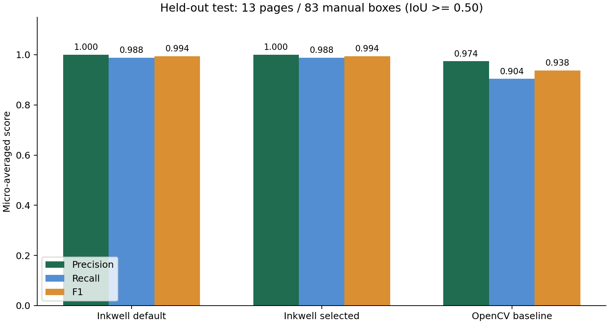

# 公开版本说明

本报告来自完整课程报告，省略未授权分发的漫画插图和私人封面。实验数字不变，原图不随包发布。

# 基于预训练目标检测与任务工作流的漫画分镜检测与导出助手

机器学习课程实验报告

姓名：________　　学号：________　　班级：________

课程名称：机器学习　　指导教师：________　　日期：2026年11月18日

## 摘要

漫画分镜的手工框选和裁剪重复性较高，斜切、嵌套与画面相连的版式又增加了自动处理难度。本项目实现一个本地漫画分镜检测与导出助手，复用已经训练好的 Inkwell YOLOv8-n ONNX 检测权重，通过自编任务工作流完成输入检查、模型调用、坐标还原、异常提示和文件导出，并提供网页上传与人工标注入口。项目不训练或微调模型，而是在固定开发集上实质性配置推理参数，使用 OpenCV 轮廓方法作为对照。在人工标注的5页开发集和13页测试集上，分别完成参数选择和保留测试。IoU阈值为0.5时，选定模型的微平均 Precision、Recall、F1分别为1.0000、0.9880、0.9939，基线分别为0.9740、0.9036、0.9375。模型漏掉一张整页单格页面，逐页宏平均F1略低于基线，说明高总体指标仍需结合失败案例解释。项目还固定并实际复用 yolo-inference 开发指导 skill，保存来源、适配说明和13项专项核验证据。

关键词：漫画分镜；目标检测；ONNX；任务工作流；人工复核

## 一 需求与目标

### 1.1 目标用户与具体场景

项目的初始目的，是方便早期漫画和未翻译原文漫画（俗称“生肉漫画”）的读者阅读，并为人工翻译提供清晰的局部画面。目标用户包括在电脑或小屏设备上阅读扫描漫画的读者，以及需要结合对白、人物表情和前后语境进行翻译的使用者。典型场景是整页画面缩放后文字偏小，读者反复放大、拖动寻找下一格；翻译者则需要反复截取局部、命名和整理图片。

现有痛点不仅是裁剪操作重复，还包括早期漫画画面密集、扫描质量不一、斜切和嵌套分镜使手工整理费时。项目将整页输入转换为可预览、可单独打开并放大的分镜图片，同时保存原图坐标供回查，减少重复框选，为对照原文与画面提供条件。提高翻译准确性是应用动机，本实验没有直接验证这一效果。

### 1.2 项目范围与成功标准

本期范围为本地图片上传或目录输入、分镜轴对齐外接矩形检测、彩色及灰度预览、分镜裁剪和边界JSON导出，并提供单独的人工标注入口。导出的图片可在现有看图工具中放大阅读；系统尚不是带阅读顺序导航的完整漫画阅读器。矩形裁剪可能带入异形边缘外的相邻画面，不等同于精确抠图；不承担图像超分辨率、文本检测、OCR或自动翻译。

功能成功标准为正常图片完成检测、预览和导出，坐标与裁剪方向一致，异常输入有记录且不阻断其他页，无结果和低分数提示人工复核，重复运行可追溯。检测效果以独立测试集的一对一IoU匹配及Precision、Recall、F1判断，并与固定传统基线比较，同时公开成功与失败页。本次未预先登记“F1必须达到某值”的门槛，不事后把实测值改写成预设目标。阅读和翻译价值仅据功能与案例作初步判断，尚未进行用户耗时、可读性或翻译质量实验。

## 二 模型方法与传统基线

### 2.1 预训练模型与免训练路线

项目使用 cedarrapidsboy 发布的 Inkwell 分镜检测权重 best.onnx。模型卡将其描述为针对 panel 单类任务微调的 YOLOv8-n 检测器[1]。作者的训练工作与本项目的工程工作分别记录：本项目没有自行训练，不生成训练损失曲线，也不把作者的验证指标写成本机实测指标。机器学习环节的贡献是选择适用的已有权重、核对输入输出、适配坐标和后处理、配置参数并验证实际效果。

本地使用ONNX Runtime 1.19.2的CPUExecutionProvider建立并执行推理会话[2]。实际核验到动态NCHW输入和单类输出[1,5,N]，候选包含中心坐标、宽高和分数。该导出未内置NMS，由适配器执行重叠框抑制。

### 2.2 预处理与坐标还原

图片首先经过 EXIF 方向校正并转为RGB。Pillow的方向校正和灰度操作用于保持显示、坐标与导出的一致性[3]。模型输入采用等比例缩放并留白至640×640，转为float32、NCHW布局，像素除以255。RGB通道顺序通过纯红输入的张量检查验证，避免直接套用BGR示例造成通道颠倒。

设原图尺寸为W、H，缩放后的实际尺寸为W′、H′，左、上留白为L、T，则横纵比例为sx=W′/W、sy=H′/H。模型中心宽高框转换到左上角后，使用 x=(x′−L)/sx、y=(y′−T)/sy 还原，再裁剪到图像范围。导出统一采用左上角像素格式[x,y,width,height]。最小边界向下取整、最大边界向上取整，非整比例测试允许约1像素取整误差。

候选经置信度过滤后按分数排序，使用IoU进行NMS。合法嵌套框不因包含关系直接删除，但高IoU重叠仍可能受NMS影响。Ultralytics推理说明区分置信度、输入尺寸与后处理配置[4]；本项目实际配置以固定权重元数据和自编适配器为准。编号仅用于标识，不表示阅读顺序；分数也不是经过校准的正确概率。

### 2.3 OpenCV轮廓基线

基线先将图片转为灰度，通过Otsu阈值获得暗区域，再提取外部轮廓并计算外接矩形。OpenCV提供轮廓查找与外接矩形接口[5]。项目保留面积不少于整页2%、短边不少于10像素的候选，不旋转输入，也不提供概率分数，confidence保存为null。该方法简单且运行快，但连通画面可能合并，嵌套区域可能被忽略；这些局限需要通过实际测试说明。

### 2.4 关键选择与备选方案

初期预定备选路线为自行训练分镜检测模型：先收集跨作品图片并制定标注协议，再按作品划分训练、验证、测试集，用通用预训练检测器开展迁移学习，记录训练配置、损失与定位指标。该路线有机会针对早期漫画和整页单格适配，但需要更多标注、计算资源和独立验证；现有18页标注不足以支撑可靠的跨作品训练结论。本期没有执行训练，不能将这一方案写成已完成实验。

最终选择专用预训练分镜权重[1]加本地ONNX推理[2]，以课程周期内形成可复核的系统与评估。另一备选是仅用轮廓规则[5]，成本低、CPU快，故保留为实测基线。边缘精确裁剪可考虑实例分割，但需要多边形或掩码标注，超出本期范围。系统侧采用确定性任务工作流，便于复现与定位失败；大模型自主规划会增加外部依赖，对当前固定输入输出任务的收益尚无证据。

## 三 方案与系统设计

### 3.1 任务组织与结果状态

系统使用规则驱动的任务Agent组织操作：网页或CLI接收图片 → 格式与大小校验 → 加载或复用检测器 → 预处理与推理 → 坐标还原与NMS → 生成状态和复核提示 → 保存预览、裁剪与JSON。网页返回可查看及下载的结果，人工根据提示回查原图；标注入口独立管理评估真值。该Agent协调工具、数据和异常交付，运行时不依赖大模型API，也不声称具备自主规划或通用对话能力。

每页结果保存来源、尺寸、检测器、权重摘要、参数、状态、警告、耗时及分镜列表。正常处理且未触发自动警告标记success；空结果、低于复核阈值的分数或异常细框标记needs_review；图片不可读或处理异常标记failed。success不表示人工认可，human_verified默认false。故意损坏的图片会留下失败记录，目录任务继续处理其他页。

CLI支持单张与递归目录输入，每次创建新的运行目录，每页保存JSON、彩色标框图、灰度标框图、纯灰度图和裁剪文件。为改善原先红线在彩色漫画上不明显的问题，预览使用多色粗框、白色衬线和醒目编号。灰度仅用于人工展示，模型仍读取RGB原图，避免无意改变推理输入。

### 3.2 网页与人工真值管理

本地网页提供图片上传、任务调用、三种预览切换、原始尺寸查看、坐标表格和边界JSON下载。服务仅监听127.0.0.1，上传和推理在本机进行；模型首次调用加载后复用。接口限制图片大小和像素数，并校验下载路径，防止网页任意读取项目文件。

人工标注页直接读取漫画目录的原图，支持新增、移动、四角缩放、删除、精确坐标、撤销、灰度查看与缩放。标注从空白开始，和模型预测分开保存。未完成页面保存为草稿；只有使用者检查整页、明确勾选核验并保存后，才进入开发或测试真值汇总。每次保存保留历史版本，并记录原图SHA256、方向校正尺寸、划分、备注和时间，便于追溯后续修改。

## 四 开源skill复用与适配证据

项目复用 Ultralytics 官方 yolo-inference skill，固定提交为11e45578024f8bcfdcf1ff3faf2d9e8a80e3c919，保存原始SKILL.md、仓库AGPL v3许可证和文件SHA256[6]。该skill是面向开发者或开发代理的推理操作指导，不是分镜模型，也不是ONNX执行库。其上游示例主要使用Ultralytics API；本项目将适用部分改写为本地ONNX验证脚本，没有调用未安装的YOLO或Results接口。

复用内容包括检查输入尺寸、明确conf和IoU含义、辨别RGB/BGR、区分中心宽高与左上角宽高、核验坐标偏移、保存分数和裁剪、预热后计时。新增verify_skill_reuse.py，在既有开发页6和9上运行正常与低分数案例，并补充空白、损坏输入。结果共13项专项检查通过，正常页得到6框，低分数页触发复核，空白页不回退为整页框，损坏文件保存明确失败。

参数行为核验也保留实际输出：第9页固定NMS=0.45时，conf=0.10、0.25、0.50分别得到6、6、4框；固定conf=0.25时，NMS=0.30、0.45、0.60分别得到5、6、7框。该对照只证明配置影响候选，不把数量变化等同于精度改善。skill用于开发辅助的真实操作与适配分析，运行时Agent仍调用自编检测工具；两者的职责与归属分别说明。

## 五 数据划分与实验协议

输入目录包含同一册Doctor Strange Sorcerer Supreme第1期的30张JPG及一个CBZ。项目直接读取已有JPG，不重复解包。图片由使用者提供，仅在本地处理；数据的进一步分享授权尚未核验，不能因用于课程就视为可公开分发。最终核验18页、111框，开发集为第6、8、9、11、12页，共28框；测试集为第13至25页，共83框。其余页未计入本次指标。

真值由使用者从空白框手动拖拽绘制，未逐框精修。使用者估计标注质量在95%以上，该估计没有独立复核，不作为标注准确率、统计置信度或模型阈值。自动检查确认原图哈希和尺寸一致，框有正面积且不越界，开发/测试无重复图片；这些检查验证结构与来源，不能证明语义标注完全正确。

仅在开发集比较conf={0.10,0.25,0.40,0.50,0.65}与NMS={0.30,0.45,0.60}的15组配置。先最大化IoU=0.5下的微平均F1，再以Precision及接近默认值打破平局。选定配置在测试预测前保存为冻结文件，随后比较默认模型、选定模型和固定OpenCV基线，不根据测试结果继续选参数。

预测框与真值框的IoU达到阈值才建立可匹配关系，使用最大基数二分图进行一对一匹配。TP为命中框数，FP为未匹配预测，FN为未匹配真值。Precision=TP/(TP+FP)，Recall=TP/(TP+FN)，F1=2TP/(2TP+FP+FN)，零分母取0。主表按框微平均，并补充逐页F1的宏平均。无检测结果仍参加评估，失败预测按空预测计数；同时比较IoU=0.30、0.50、0.75以观察边界匹配的敏感性。

## 六 实验结果与分析

### 6.1 开发集参数对照

默认conf=0.25、NMS=0.45得到TP28、FP2、FN0，微平均F1为0.9655。选择conf=0.40、NMS=0.45后，开发集TP28、FP0、FN0，F1为1.0000。更高阈值0.65则出现漏框，说明减少低分候选也可能损害召回。该配置改进有开发集证据，但小开发集上的满分不能当作泛化能力证明。

### 6.2 保留测试结果

表1为IoU≥0.5时的13页测试结果，三种方法均无运行失败。

| 方法 | TP | FP | FN | Precision | Recall | 微平均F1 | 宏平均F1 |
|---|---:|---:|---:|---:|---:|---:|---:|
| Inkwell默认配置 | 82 | 0 | 1 | 1.0000 | 0.9880 | 0.9939 | 0.9231 |
| Inkwell选定配置 | 82 | 0 | 1 | 1.0000 | 0.9880 | 0.9939 | 0.9231 |
| OpenCV基线 | 75 | 2 | 8 | 0.9740 | 0.9036 | 0.9375 | 0.9345 |

模型在按框汇总时更好，减少了基线的漏检和误检；但默认与选定配置的测试指标相同，不能宣称调参提高了测试精度。逐页等权时模型宏平均F1反而略低，原因是其在第18页完全没有输出分镜，而该页只有一个人工框。这说明多格页面对微平均贡献较大，单格页的完全失败可能被高总分掩盖，应同时报告两类平均。



图1 相同真值与匹配规则下的测试指标，数据来自本机实验。

### 6.3 成功案例


公开版省略原漫画对照图，保留以下逐页结果和误差分析。

第13页包含8个人工框，选定模型与基线均得到TP8、FP0、FN0，F1为1.0000。第13页结果说明系统能够将多行不同宽度的分镜定位并用于后续裁剪；编号因输出顺序不同而不一致，不影响一对一几何匹配，也不能作为阅读顺序使用。第14页7框也全部命中，两种方法均无误检。这些成功页展示了可用结果，并不说明模型在所有布局上均优于基线；模型优势主要体现在第15、16、17、19、25页减少漏框或误框，证据见逐页CSV。

### 6.4 边界误差与失败案例

| 方法 | F1在IoU0.30 | F1在IoU0.50 | F1在IoU0.75 |
|---|---:|---:|---:|
| Inkwell默认及选定配置 | 0.9939 | 0.9939 | 0.9939 |
| OpenCV基线 | 0.9625 | 0.9375 | 0.9000 |

模型已命中的框对本次三个IoU阈值稳定；基线随匹配变严格而下降，表明部分候选定位不够贴合。该分析不能反推出人工标注误差为多少，也不能据此认定标注质量超过95%。单人标注的边界歧义和漏标风险仍然存在。


公开版省略原漫画对照图，保留以下逐页结果和误差分析。

模型漏掉整页单幅画面，基线却能检出。系统保留0框和复核提示，没有自动输出整页框掩盖失败。可能原因是单格页缺少格间分隔特征，或与预训练分布存在差异；本项目未检查训练样本和模型内部响应，故仅作为待验证假设。基线在第15、16、17、19、25页出现误检或漏检，其连通区域合并和外部轮廓假设是可能误差来源。另有轴对齐框带入相邻画面、粗标边界歧义及高IoU候选受NMS抑制的风险。项目未预先建立规则/异形分类真值，因而不虚构分组精度。

预热后逐页单次运行，默认模型、选定模型和基线的平均推理耗时约为81.38、82.30、5.83毫秒，包含预处理和后处理，不含模型加载、读图及导出。基线在本轮CPU测试更快，模型获得更好的按框定位指标；执行顺序、缓存和系统负载会影响时间，因此这些值只用于描述本机条件，不作为严格性能基准。

## 七 测试验证与复现

项目使用独立Python 3.9.13环境，固定依赖版本、权重提交及SHA256。8项回归测试通过，覆盖坐标还原、一对一匹配、中文路径导出、异常细框、上传下载及标注校验；skill专项13项另计，均不作为准确率样本。

原始快照与逐页CSV保存在evaluation/published/20261116_112754，重评创建新目录。建议参数见configs/evaluated.json，网页默认仍为0.25/0.45。浏览器已验证上传检测、预览切换与JSON下载；标注拖动未完成自动浏览器验证，使用者已通过网页完成真实标注。主要函数、依赖、运行命令和测试样例集中列于参考文献后的附录。

## 八 讨论与改进

### 8.1 真实使用价值判断

现有结果支持将系统作为“自动生成候选分镜、人工检查后放大阅读或整理翻译材料”的辅助工具。在成功页上，坐标与裁剪输出使读者不必逐格重新框选，灰度标框预览方便辨认边界，原图回查保留对白和前后语境。相比仅调用预测接口，完整导出流程更接近实际使用需要。本次测试中模型按框F1优于基线，说明专用检测模型有应用价值；但尚无人工操作耗时对照、读者测试或翻译评分，不能声称已证明节省多少时间或提高多少翻译准确率。

### 8.2 风险与适用边界

漏框可能让读者遗漏剧情，裁剪过紧可能切断对白，错框或相邻内容混入可能造成语境误解。处理完成状态和高分均不能代替人工确认，使用时应保留原图，逐页核验后再整理或翻译；不宜直接把未复核的裁剪作为唯一阅读材料。编号不表示阅读顺序，灰度也不恢复低清原图细节。本系统没有执行文字识别或翻译，不对译文准确性作保证。

上传与推理在本机完成，适合不希望将图片发送到外部服务的场景；本地输出和日志仍可能包含原图内容或路径，需要由使用者管理和清理。漫画分享授权尚未核验，报告案例用于课程说明，公开发布前仍需确认授权；模型与skill的来源和许可分别记录[1][6]，后续分发应先核查对应条款。当前仅按本机使用设计，未提供面向公网的账户鉴权，不能直接作为开放网络服务部署。

### 8.3 实验局限与后续改进

当前证据来自单册、小样本和单人粗框标注，跨作品泛化有限，是否与模型预训练数据重叠也未知。模型宏平均F1低于基线提示单格整页失败仍重要；开发集调参虽减少误检，测试指标并未进一步提高。下一步优先增加跨作品与跨扫描质量测试，开展独立复核，并针对整页单格、嵌套和重叠布局补充样例。在数据充分后再实施第2.4节的迁移训练，以作品隔离的测试集与现有权重公平比较。

面向阅读需求，可增加人工确认阅读顺序和逐格导航；面向翻译，可先加入框内文本检测，再独立评估文本召回与裁剪完整性；异形精裁则研究分割。真实使用验证可对比手工框选与辅助工具的任务耗时、漏格率和满意度；若检验翻译收益，还需独立译者和明确评分协议。这些均为后续计划，不计作已完成工作。

## AI辅助与工作归属说明

Codex辅助需求整理、代码生成、环境调试、测试与实验执行及报告整理；使用者提供资料、确定需求，并从空白框绘制、核验人工标注。模型预训练归原作者，ONNX Runtime负责推理，skill来自Ultralytics；项目自编部分包括坐标适配、工作流、网页、标注与评估。报告数字对应已保存记录，AI辅助不作为独立手写成果申报。

## 参考文献

[1] cedarrapidsboy. Inkwell Panel Models 模型说明与权重. 固定提交fa7afba52ba7dc7b0840c7702b767972b5e17a9b. https://huggingface.co/cedarrapidsboy/inkwell-panel-models/tree/fa7afba52ba7dc7b0840c7702b767972b5e17a9b ，访问日期2026-11-16.

[2] Microsoft. ONNX Runtime Python 官方文档. https://onnxruntime.ai/docs/get-started/with-python.html ，访问日期2026-11-16. 实验安装版本为1.19.2，在线文档可能更新。

[3] Pillow Contributors. ImageOps 官方文档. https://pillow.readthedocs.io/en/stable/reference/ImageOps.html ，访问日期2026-11-16. 实验安装版本为11.3.0。

[4] Ultralytics. Predict Mode 官方说明. https://docs.ultralytics.com/modes/predict/ ，访问日期2026-11-16. 参数概念参考，实际YOLOv8 ONNX约定以本地元数据为准。

[5] OpenCV. Structural Analysis and Shape Descriptors 官方文档. https://docs.opencv.org/4.x/d3/dc0/group__imgproc__shape.html ，访问日期2026-11-16. 实验安装版本为4.11.0.86。

[6] Ultralytics. yolo-inference Skill. 固定提交11e45578024f8bcfdcf1ff3faf2d9e8a80e3c919. https://github.com/ultralytics/skills/blob/11e45578024f8bcfdcf1ff3faf2d9e8a80e3c919/skills/yolo-inference/SKILL.md . 源文档与许可证已在项目内存档，2026-11-12获取并执行验证。

## 附录A 主要代码框架

以下为自编代码的关键类与函数，完整源码随项目提交，第三方模型及skill分别对应参考文献[1][6]，库接口参考[2]—[5]。

panel_assistant.py：Inkwell.__init__建立ONNX会话，Inkwell.detect完成模型检测；letterbox和restore负责缩放与坐标还原；iou提供重叠计算；Baseline.detect实现轮廓基线；process组织单页检查、状态和文件导出；draw_panels绘制预览，main处理CLI批任务。

web_server.py：WorkflowAgent.run组织上传检测并复用模型；Handler.do_POST和Handler.do_GET处理上传、标注与下载；main启动本地服务。web/index.html和web/annotate.html分别提供检测展示与人工标注。

annotations.py：AnnotationStore.pages列出图片，load读取标注，save校验并保存草稿、核验记录、历史及数据划分。evaluate.py：match执行最大基数一对一匹配，metrics计算P/R/F1。scripts/run_evaluation.py：score和main组织开发集网格搜索、冻结参数及测试评估。scripts/verify_skill_reuse.py保存专项核验证据。

## 附录B 运行方法与依赖

在项目根目录打开PowerShell。已有.venv和models/best.onnx时可直接启动；迁移到新机器时先用以下命令安装锁定依赖并下载固定权重，下载步骤需要联网。Python版本为3.9.13，运行时无需大模型API密钥。

```powershell
py -3.9 -m venv .venv
& .\.venv\Scripts\python.exe -m pip install -r requirements-lock.txt
& .\.venv\Scripts\python.exe scripts/download_model.py
& .\.venv\Scripts\python.exe web_server.py
```

浏览器打开http://127.0.0.1:8877，标注入口为/annotate，按Ctrl+C停止服务。直接依赖为numpy==1.26.4、pillow==11.3.0、opencv-python-headless==4.11.0.86、onnxruntime==1.19.2，间接依赖见requirements-lock.txt。OpenCV与ONNX Runtime分别承担基线与推理[5][2]，Pillow承担图片处理[3]。无需安装Ultralytics Python包；skill作为开发指导复用，不是运行依赖。

批量采用实验选定参数时执行以下命令。网页默认仍为0.25/0.45；本命令显式指定0.40/0.45，输出位于outputs下新的运行目录。

```powershell
& .\.venv\Scripts\python.exe panel_assistant.py 漫画 --confidence 0.40 --nms 0.45
& .\.venv\Scripts\python.exe panel_assistant.py 漫画 --detector baseline
& .\.venv\Scripts\python.exe scripts/run_evaluation.py
```

## 附录C 测试样例与预期结果

原真实样例不公开分发；以下按历史页码标识：第13页（…_13.jpg）8框，第14页7框，选定模型在IoU≥0.5下均无误检漏检；第18页1个人工框、模型0框，预期needs_review。复核本次固定结果应查看evaluation/published/20261116_112754中的真值快照、逐页CSV和预测记录，不以网页默认参数替代冻结配置。

scripts/create_debug_samples.py生成的evaluation/synthetic含合成三格、空白和故意损坏图片。已记录模型分别输出3框、0框和failed，空白为needs_review；目录任务含损坏文件时返回码1属于预期。该样例仅用于流程调试，不计入真实漫画精度。8项回归测试位于tests/test_core.py、test_web.py和test_annotations.py，覆盖坐标、一对一匹配、导出异常、上传下载和标注校验；skill专项13项另见SKILL_REUSE.md。

```powershell
& .\.venv\Scripts\python.exe -m unittest discover -s tests -v
& .\.venv\Scripts\python.exe scripts/create_debug_samples.py
& .\.venv\Scripts\python.exe panel_assistant.py evaluation/synthetic
& .\.venv\Scripts\python.exe scripts/verify_skill_reuse.py
```


## 附录D 代码与复现入口

主要函数、环境、命令和测试样例见REPRODUCE.md；许可归属见../NOTICE.md；提交清单见../SUBMISSION.md。
历史指标与几何记录见../evaluation/published/20261116_112754，可运行scripts/check_published_metrics.py复算。
原漫画插图及私人封面不随公开版分发，个人信息保留空白。完整含插图报告保存在私有项目中。
